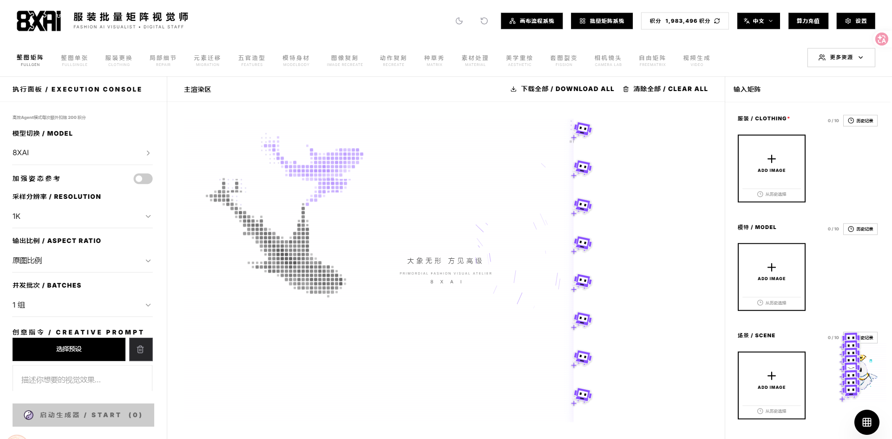
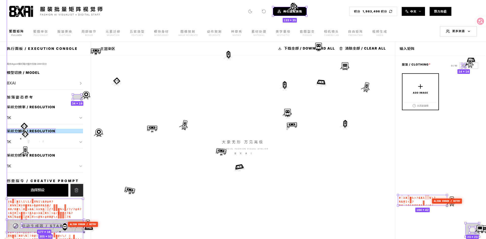
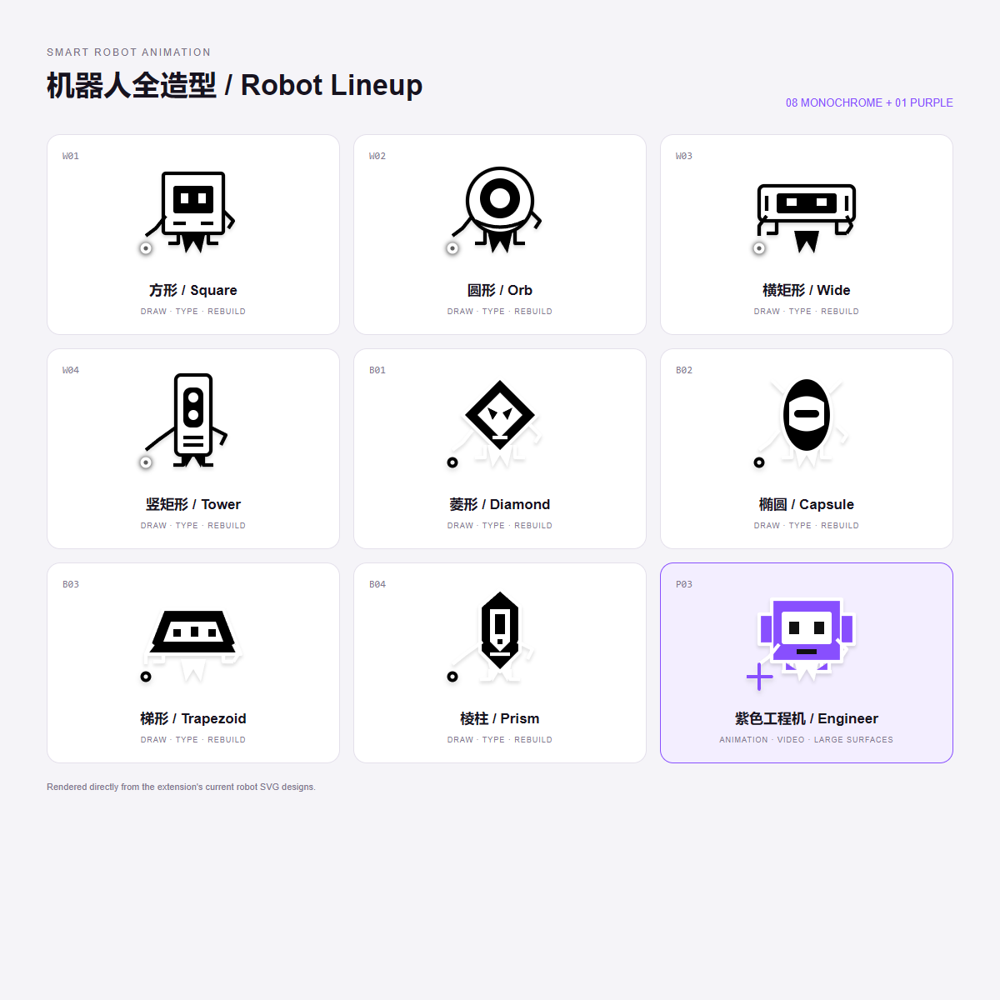

# Smart Robot Animation — User Guide

[简体中文](swarm-rebuild/README.zh-CN.md) · [Privacy Policy](swarm-rebuild/PRIVACY.md)

Smart Robot Animation is a Chrome / Microsoft Edge extension that redraws the current page in a visual overlay using animated robot crews. Once the available work finishes, the robots return to your pointer, disappear, and the overlay closes automatically.

## Interface and robot showcase

The following screenshots show this modified version in use.

### Purple crew revealing animated content



### Monochrome robots drawing and repairing regions



### Complete robot lineup

The overview contains all current designs: four white robots, four black robots and one purple engineer. It is rendered directly from the extension's SVG designs.



### Animation demonstration video

[Open or download the full demonstration (MP4, approximately 6.5 MiB)](swarm-rebuild/assets/robot-animation-demo.mp4)

<video controls preload="none" poster="swarm-rebuild/assets/interface-purple-crew.png" src="swarm-rebuild/assets/robot-animation-demo.mp4" width="960"></video>

Some Markdown platforms do not display embedded video. Use the link above or open `assets/robot-animation-demo.mp4` directly. The video is included in the local package; online presentation requires uploading these files to your chosen repository or website.

## Origin and modifications

**This project is based on [DhvanilPatel/swarm-cursors](https://github.com/DhvanilPatel/swarm-cursors), whose upstream extension is named Swarm Rebuild. It makes partial changes to the original project's logic and appearance; it is not an independently developed implementation written entirely from scratch.** Refactoring the code or renaming internal methods and variables does not change that origin.

The upstream README also credits Joel Califa's [Swarm](https://califa.github.io/swarm-site/) ([source](https://github.com/califa/swarm-site)) as the source of portions of its animation engine and motion design. We acknowledge that contribution as well.

The main changes in this version are:

- Distinct black and white robot designs in place of the cursor crew, plus purple engineer robots.
- Revised scheduling, repair attempts, explosion/replacement effects, misplaced drawing followed by relocation, and individual return behavior.
- Recognized animation and video regions are processed after ordinary drawing tasks, with eight purple robots working together.
- A single continuous reveal mask: left to right for centered/left regions, right to left for right-side regions. Video frames follow the original player's live timeline.
- Temporary cyber glitch effects during media drawing and redesigned synthesized audio.
- Purple/green measurement graphics, no central opening page logo, a hidden bottom control bar, and automatic exit.
- Refactored internal names, script entry points and portions of method organization. Launching uses a keyboard shortcut rather than a browser toolbar action.

Applicable attribution, copyright and license requirements for upstream code and third-party assets still apply. This guide does not grant additional rights to third-party code or assets; check their respective sources. This modified version does not represent, and is not endorsed by, the upstream authors.

## 1. Locate the extension folder

On this computer, the folder is:

```text
I:\鼠标\swarm-rebuild
```

If you moved or downloaded the extension elsewhere, use that location. Select the folder that **directly contains `manifest.json`**, not its parent folder or an individual JavaScript file.

```text
swarm-rebuild/
├── manifest.json
├── extension-worker.js
├── pointer-tracker.js
├── robot-scene.js
├── assets/
│   └── robot-explosion.gif
├── icons/
│   ├── icon16.png
│   ├── icon32.png
│   ├── icon48.png
│   └── icon128.png
├── README.zh-CN.md
├── README.md
├── PRIVACY.zh-CN.md
└── PRIVACY.md
```

No BAT launcher, Node.js installation, local server or build command is needed. If the files are in a ZIP archive, extract them first. Keep the installed folder in a stable location.

## 2. Open the browser's extension manager

### Google Chrome

1. Open Chrome.
2. Enter `chrome://extensions/` in the address bar and press Enter.
3. Turn on **Developer mode** in the upper-right corner.
4. The **Load unpacked** button will appear near the top of the page.

Alternatively, open the browser menu and choose **Extensions → Manage Extensions**. Menu wording may vary by version.

### Microsoft Edge

1. Open Edge.
2. Enter `edge://extensions/` in the address bar and press Enter.
3. Turn on **Developer mode** on the extension management page.
4. Find the **Load unpacked** button.

## 3. Load and enable the extension

1. Click **Load unpacked**.
2. Browse to `I:\鼠标\swarm-rebuild`, or your actual extension location.
3. Select the entire folder and click **Select Folder**.
4. Confirm that **Smart Robot Animation** appears in the extension list.
5. Make sure its enable switch is on.
6. Open **Details** to check its name, version and site access settings.

**This version has no toolbar launch button.** You do not need to pin it next to the address bar. Confirm installation using the extension card on the management page, rather than looking for a toolbar button.

## 4. Check the launch shortcut

The default shortcut is **Alt + Shift + S**. Check the binding manually if you previously installed another version or have a shortcut conflict.

1. In Chrome, open `chrome://extensions/shortcuts`. In Edge, open `edge://extensions/shortcuts`.
2. Find **Smart Robot Animation**.
3. Locate **Animate this page with the robot crew**.
4. Click its shortcut field.
5. Press **Alt + Shift + S** together. If the browser reports a conflict, choose another permitted, unused combination.
6. Click outside the field and confirm that the shortcut is displayed.

On macOS, Alt corresponds to Option. Reassign the shortcut on this page if the operating system or browser intercepts it.

## 5. Play the animation

1. Open an ordinary webpage, such as an `https://` website.
2. Wait for its main content and media to load. To show a playing video, start the original video first.
3. If the tab was already open before installation or an update, refresh it once so the pointer tracker can load.
4. Move your pointer to the desired launch position and keep focus in the webpage content area.
5. Press **Alt + Shift + S**, or your assigned shortcut.
6. The extension reads the page layout, may briefly scroll to activate lazy content, and starts the robot drawing overlay.
7. You can move the pointer while drawing. Robots return toward its current position when they finish. Scroll the page when you want lower content to enter the working area.
8. After ordinary content, purple crews reveal recognized animation and video regions together. Videos use the original player's current frames rather than restarting a separate playback timeline.
9. Once work within the available scope is finished and the robots have returned, the overlay closes and normal webpage interaction resumes.

The animation does not stay open indefinitely waiting for lower, offscreen content. You can scroll to that content and launch another run.

### Controls

| Action | Control |
| --- | --- |
| Start | Press the launch shortcut on the target webpage |
| Exit early | Press **Esc** |
| Toggle off | Press the launch shortcut again while running |
| Toggle sound effects | Press **M** while running |
| Unlock audio blocked by the browser | Click once inside the page; press M if needed |
| Play again | Press the launch shortcut after the previous run exits |

The bottom control bar is hidden. There are no visible Tour, speed, Replay or toolbar launch buttons in this version. The sound toggle controls robot effects only; it does not mute or pause the original page's video.

## 6. Apply code updates

1. Replace the files in the same extension folder, keeping required resources such as `assets` and `icons`.
2. Open `chrome://extensions/` or `edge://extensions/`.
3. Click **Reload**, usually shown as a circular arrow, on the **Smart Robot Animation** card.
4. Return to the target webpage and refresh it using the browser's refresh button or `Ctrl + R`.
5. Wait for the page to load, then press the launch shortcut.

Refreshing a webpage alone does not reload the extension's background code. Reloading the extension alone does not replace scripts already injected into an existing page. Complete both steps 3 and 4 after updating.

## 7. Troubleshooting

### The extension does not appear in the list

- Enable Developer mode and use **Load unpacked**.
- Select the folder containing `manifest.json` directly.
- Look for **Smart Robot Animation**, rather than the old name Swarm Rebuild.
- If loading fails, read the browser's error and check that the package was fully extracted.

### It is installed, but there is no button next to the address bar

This is intentional. Verify that the extension is enabled in the extension manager and use its keyboard shortcut.

### The shortcut does nothing

1. Verify that a shortcut is assigned and is not intercepted by another application.
2. Focus an ordinary webpage's content area. Do not launch from the address bar or the extension management page.
3. Check that the extension is enabled and allowed to access the target site.
4. Reload the extension and refresh the webpage, then try again.
5. The browser may block injection on protected pages, including the Chrome Web Store, browser settings, `chrome://` / `edge://` pages and built-in PDF viewers.

### Local HTML files

Open the extension's **Details**, enable **Allow access to file URLs**, then reopen or refresh the `file://` page.

### Incognito / InPrivate windows

Extensions are usually disabled there by default. If you need this mode, enable the corresponding option in the extension's Details and open the target page in that window.

### No sound

Click once inside the page to satisfy the browser's audio gesture requirement. While the animation is running, press **M** to check the sound toggle, and make sure the tab is not muted.

### Some content is missing or looks different

Reconstruction uses accessible DOM content, computed styles and media frames. Cross-origin embeds, closed shadow roots, protected video, unloaded resources and complex layouts can limit capture fidelity. The overlay reproduces appearance; it is not a fully functional clone of the webpage.

## 8. Privacy and removal

Read the [Privacy Policy](swarm-rebuild/PRIVACY.md) before use.

To disable or remove the extension, open the extension manager and switch it off or click **Remove**. Refresh previously opened webpages afterward to clear their injected scripts and in-memory state.
