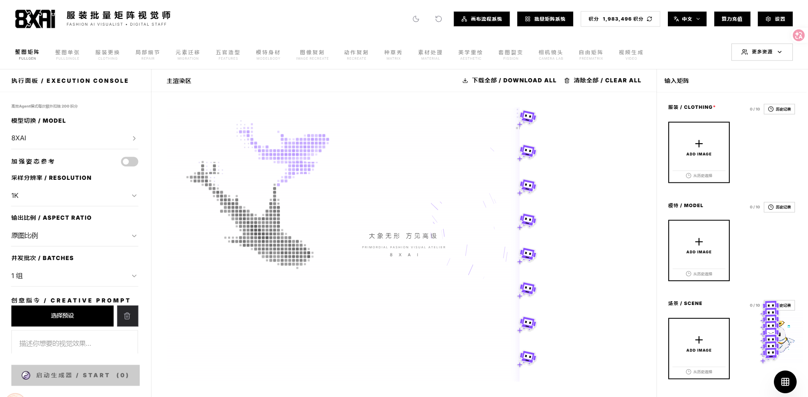
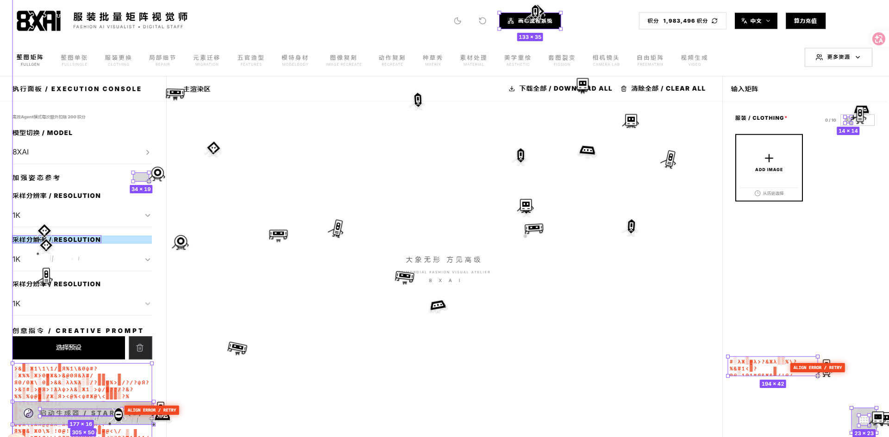
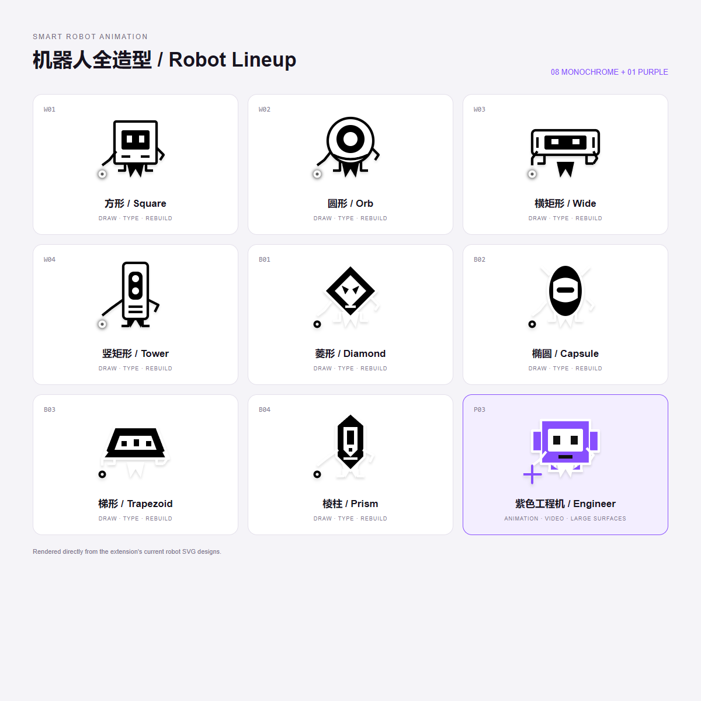

# Smart Robot Animation 使用说明

[English](swarm-rebuild/README.md) · [隐私政策](swarm-rebuild/PRIVACY.zh-CN.md)

Smart Robot Animation（智能机器人动画插件）是一个 Chrome / Microsoft Edge 浏览器扩展。启动后，机器人会在覆盖层中重新绘制当前网页；任务完成后，机器人回到鼠标位置并消失，覆盖层自动退出，恢复网页操作。

## 浏览器快捷键（先看这里）

**安装并启用插件后，打开目标网页，点击网页内容区域，再按 `Alt + Shift + S` 启动动画。** 本版本没有浏览器工具栏启动按钮。

| 快捷键 | 功能 |
| --- | --- |
| **Alt + Shift + S** | 启动当前网页的机器人动画；运行时再次按下可退出 |
| **Esc** | 立即退出当前动画 |
| **M** | 动画运行时开启或关闭机器人音效 |

Chrome 和 Edge 均使用上述默认快捷键。macOS 上 Alt 对应 **Option（⌥）**。若安装后无反应或快捷键冲突，请打开 Chrome 的 `chrome://extensions/shortcuts` 或 Edge 的 `edge://extensions/shortcuts`，找到 **Smart Robot Animation → Animate this page with the robot crew**，点击快捷键输入框并按下 `Alt + Shift + S` 完成绑定。安装或更新后，先刷新目标网页再使用。

## 界面与机器人展示

以下两张截图由本修改版的实际运行画面提供。

### 紫色机器人协作绘制动画



### 黑白机器人绘制与错误返工



### 全部机器人造型

总览包含当前代码中的 4 种白色机器人、4 种黑色机器人及 1 种紫色工程机器人，直接使用插件的 SVG 造型生成。



### 动画演示视频

[打开或下载完整演示视频（MP4，约 6.5 MiB）](swarm-rebuild/assets/robot-animation-demo.mp4)


上方 GIF 可在 GitHub 说明页直接播放，包含完整演示过程，循环播放且无音轨。需要查看原始画质和音效时，请使用 MP4 链接下载后播放。

## 项目来源与修改声明

**本项目基于 [DhvanilPatel/swarm-cursors](https://github.com/DhvanilPatel/swarm-cursors)（上游名称：Swarm Rebuild）进行修改，在原项目基础上做了部分逻辑和外观更改，并非完全从零独立开发。** 内部代码的重构、变量和方法更名，不改变这一来源关系。

上游 README 还说明，其部分动画引擎及动效设计改编自 Joel Califa 的 [Swarm](https://califa.github.io/swarm-site/)（[源代码](https://github.com/califa/swarm-site)）。在此一并致谢。

本版本的主要调整包括：

- 将光标群改为具有不同外形和动态效果的黑白机器人，增加紫色工程机器人。
- 调整任务调度、失败返工、爆炸替换、错位绘制后推移和独立收拢逻辑。
- 将识别出的动画与视频区域安排在普通绘制任务之后，由 8 只紫色机器人协作完成。
- 动画区域使用连续遮罩揭示：居中或偏左时从左到右，偏右时从右到左；视频画面跟随原播放器实时更新。
- 增加绘制期间的故障撕裂、扫描线和紫青色干扰效果，并重新设计合成音效。
- 调整坐标线及标尺配色，取消开场中央页面 Logo，隐藏底部操作条，完成后自动退出。
- 重构内部命名、脚本入口和部分方法组织，改为通过快捷键启动，不提供浏览器工具栏启动按钮。

原项目及相关第三方代码、素材的署名、版权和许可要求仍需遵守。本说明不额外授予第三方代码或素材的使用权；具体要求请核对相关来源。本修改版不代表上游作者或获得其背书。

## 一、确认插件文件夹

本机插件目录为：

```text
I:\鼠标\swarm-rebuild
```

如果你已移动或下载到其他位置，使用实际位置即可。需要选择的是**直接包含 `manifest.json` 的文件夹**，而不是它的上级目录，也不是某一个 JavaScript 文件。

```text
swarm-rebuild/
├── manifest.json
├── extension-worker.js
├── pointer-tracker.js
├── robot-scene.js
├── assets/
│   └── robot-explosion.gif
├── icons/
│   ├── icon16.png
│   ├── icon32.png
│   ├── icon48.png
│   └── icon128.png
├── README.zh-CN.md
├── README.md
├── PRIVACY.zh-CN.md
└── PRIVACY.md
```

这是可直接加载的浏览器扩展，无需运行 BAT、安装 Node.js、启动本地服务器或执行构建命令。如果文件仍在 ZIP 压缩包内，先解压到固定目录，安装后不要随意移动该目录。

## 二、打开浏览器扩展管理页

### Google Chrome

1. 打开 Chrome。
2. 在地址栏输入 `chrome://extensions/`，按回车。
3. 打开页面右上角的 **开发者模式** 开关。
4. 页面上方会显示 **加载已解压的扩展程序** 按钮。

也可以从右上角菜单进入 **扩展程序 → 管理扩展程序**；不同版本的菜单名称可能略有区别。

### Microsoft Edge

1. 打开 Edge。
2. 在地址栏输入 `edge://extensions/`，按回车。
3. 打开扩展管理页中的 **开发人员模式 / 开发者模式**。
4. 找到 **加载解压缩的扩展 / 加载已解压的扩展程序** 按钮。

## 三、加载并启用插件

1. 点击 **加载已解压的扩展程序**。
2. 在文件夹选择窗口中找到 `I:\鼠标\swarm-rebuild`，或你实际保存插件的位置。
3. 选中整个文件夹，点击 **选择文件夹**。
4. 确认扩展列表中出现 **Smart Robot Animation**。
5. 确认插件卡片上的启用开关处于开启状态。
6. 点击 **详细信息** 可以查看扩展名称、版本和网站访问设置。

**本版本没有工具栏启动按钮。** 无需将插件固定到地址栏旁边，也不要通过寻找工具栏图标判断是否安装成功；请以扩展管理页中的插件卡片为准。

## 四、检查动画启动快捷键

默认快捷键为 **Alt + Shift + S**。安装过旧版本或发生快捷键冲突时，请手动检查绑定。

1. Chrome 在地址栏打开 `chrome://extensions/shortcuts`；Edge 打开 `edge://extensions/shortcuts`。
2. 找到 **Smart Robot Animation**。
3. 找到 **Animate this page with the robot crew** 命令。
4. 点击该命令旁的快捷键输入框。
5. 同时按下 **Alt + Shift + S**。如果浏览器提示冲突，改成浏览器允许且未被占用的组合键。
6. 点击输入框外侧，确认快捷键已经显示。

macOS 中 Alt 对应 Option；如果系统或浏览器拦截默认组合键，请在上述页面重新指定快捷键。

## 五、使用网页机器人动画

1. 打开你希望播放动画的普通网页，例如一个 `https://` 网站。
2. 等待网页主要内容、图片和视频加载完成。视频需要实时播放时，先在原网页启动视频。
3. 如果该标签页在安装或更新插件之前就已经打开，先刷新网页一次，让鼠标追踪脚本加载。
4. 将鼠标移动到希望机器人出发的位置，然后让网页内容区域保持焦点。
5. 按下 **Alt + Shift + S**，或你设置的新快捷键。
6. 插件会读取页面布局，必要时短暂滚动以触发懒加载，再显示机器人绘制动画。
7. 绘制过程中可以移动鼠标；结束时机器人会向当前鼠标位置收拢。需要显示下方内容时，可以滚动网页。
8. 普通内容绘制完成后，识别出的动画和视频区域由紫色机器人集体揭开。视频使用原播放器的当前画面，不另起一个播放进度。
9. 当前可处理范围内的任务结束、机器人收拢后，动画覆盖层自动退出，网页恢复可操作状态。

如果有下方尚未进入处理范围的内容，插件不会为了等待这些离屏内容而一直停留；可以滚动到对应位置后再次启动。

### 操作速查

| 操作 | 方法 |
| --- | --- |
| 启动动画 | 在目标网页按启动快捷键 |
| 提前退出 | 按 **Esc** |
| 切换退出 | 动画运行时再次按启动快捷键 |
| 切换音效 | 动画运行时按 **M** |
| 解锁被浏览器阻止的音频 | 在页面内点击一次，必要时再按 M |
| 再次播放 | 当前动画退出后，再按启动快捷键 |

底部操作条已隐藏。本版本不提供可见的 Tour、速度、Replay 或工具栏启动按钮，日常使用以上快捷键即可。扩展音效开关只控制机器人合成音效，不会替你静音或暂停原网页的视频。

## 六、更新插件代码后如何生效

1. 将新文件完整放回原来的插件文件夹，保留 `assets`、`icons` 等资源。
2. 打开 `chrome://extensions/` 或 `edge://extensions/`。
3. 在 **Smart Robot Animation** 卡片上点击 **重新加载**（通常是圆形箭头）。
4. 回到要播放动画的网页，按浏览器刷新按钮或 `Ctrl + R` 刷新网页。
5. 页面加载完成后，再使用启动快捷键。

仅刷新网页不会重新载入扩展的后台脚本；仅重新加载扩展也不会替换已注入旧页面的脚本。因此，更新后需要完成第 3、4 两步。

## 七、常见问题

### 扩展列表中找不到插件

- 确认已经开启开发者模式，并点击了“加载已解压的扩展程序”。
- 确认所选文件夹直接包含 `manifest.json`。
- 确认搜索的是 **Smart Robot Animation**，不是旧名称 Swarm Rebuild。
- 加载失败时，阅读浏览器给出的错误，并检查文件是否完整解压。

### 安装成功，但地址栏旁没有按钮

这是当前版本的设计。请在扩展管理页确认插件已启用，再通过快捷键启动。

### 按快捷键没有反应

1. 到扩展快捷键页面确认命令已绑定，且未被其他程序占用。
2. 先切回普通网页内容区域，再按快捷键；不要在地址栏或扩展管理页中启动。
3. 检查扩展是否启用，以及目标网站的访问权限是否允许。
4. 重新加载扩展并刷新网页，然后重试。
5. 在 Chrome Web Store、浏览器设置页、`chrome://` / `edge://` 页面及浏览器内置 PDF 查看器等受保护页面，浏览器可能禁止脚本注入。

### 如何在本地 HTML 文件上使用

在插件的 **详细信息** 中打开 **允许访问文件网址 / 允许访问文件 URL**，然后重新打开或刷新对应的 `file://` 页面。

### 如何在无痕 / InPrivate 窗口中使用

浏览器通常默认禁止扩展在此类窗口运行。确有需要时，在插件详细信息中手动开启相应选项，再在该窗口打开目标网页。

### 没有音效

先在页面内点击一次，满足浏览器的音频播放要求；在动画运行时按 **M** 检查音效开关，并检查标签页是否被静音。

### 个别内容没有被完整重建

插件根据可访问的 DOM、样式和媒体画面进行重建。跨域嵌入、封闭 Shadow DOM、受保护视频、尚未加载的资源及复杂布局可能存在捕获限制。重建是视觉覆盖效果，不是网页功能的完整克隆。

## 八、隐私与卸载

首次使用前可阅读 [中文隐私政策](swarm-rebuild/PRIVACY.zh-CN.md)。

停用或删除插件：打开扩展管理页，在插件卡片上关闭启用开关或点击 **移除**。随后刷新已打开的网页，清理该页面中已注入的脚本与内存缓存。
